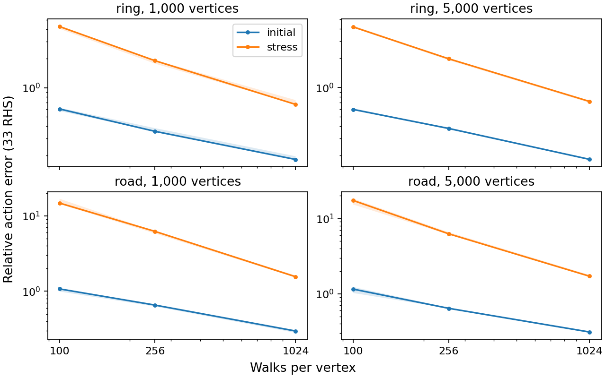

# What makes the degree-two graph GP fast?

In this pilot, applying the polynomial directly to vectors gave the largest repeatable saving.
On the 5K road graph with 33 right-hand sides, forward/backward took 2.25/4.74 ms for Chebyshev,
1.87/5.77 ms for monomial recurrence, 8.86/31.22 ms for exact sparse powers and 8.73/30.78 ms
for sampled features at W1024. Eliminating random walks from the feature implementation nearly
eliminated preprocessing cost but left its warmed cost close to GeneralGRF. Changing polynomial
coordinates also mattered: monomial gave the fastest batched forward in all four settings and
the fastest 100-update training in both regimes. Chebyshev generally had the cheaper backward pass.
These measurements help explain the historical 2.2–2.9× standalone advantage through 50K;
they do not apportion that historical ratio or establish an asymptotic law.

## What was held fixed

For symmetric graph Laplacian L, the root is q(L) = I + (a₁ − 4a₂)L + 2a₂L² and K = σ²q(L)².
Cheb uses the existing degree-four Chebyshev covariance action. Mono applies its monomial expansion
by Horner's rule through the same selected operator. Powers forms sparse I, L and L² once, then
uses the official feature action ΦΦᵀ with the current root coefficients. Its square is guarded
before construction by a 100n upper bound on candidate products. Walk uses the same action and
parameters with official sampled load matrices. The sampler's cutoff J=3 retains lengths 0, 1, 2.
Native in the learning table uses the official unconstrained three modulation coefficients, including
amplitude, initialized to the identical physical root. All arms learn observation noise.

The road graph uses the existing weighted generator with fresh replicate 12. Ring uses unit-weight
edges and L = I − A/2. One graph per family and size, one quarter of vertices selected, float64 CPU,
four Torch threads, four sampler workers, Apple M4 MacBook Air. Feature seeds were 217101, 517101
and 817101, paired across W. Initial (a₁,a₂,σ,noise variance) was (−.196612,.133612,1.313262,.693247);
the existing stress state was (−.35,.45,1.5,.05). For each width the Gaussian RHS was fixed across
methods, coefficient states and feature seeds. Width 33 represents one data column plus 32 probes.

On 36 vertices we independently formed the deterministic covariance by diagonalizing L and
evaluating q on its eigenvalues. Walk was checked against its own dense sampled ΦΦᵀ.
Across methods, states and widths the largest absolute product and raw gradient discrepancies were
1.13e−14 and 2.85e−14 (upper bounds rounded up). On the four larger graphs the greatest deterministic
relative action difference was 8.18e−15. The first tiny preflight exposed missing Torch CSR-by-CSR
multiplication on this Mac. The completed run used SciPy CSR for the one-time square and Torch for
all measured actions and fits.

## Time and sparse storage

Setup is one-time basis preparation. Values rounded to zero mean no basis construction. Model
initialization is timed separately in the raw rows. For each configuration we excluded one warmup
then timed five forwards and backwards separately, including lazy operator construction in forward
and differentiating the mean squared product in backward. Cells summarize medians across repetitions,
then across coefficient states and available feature seeds. KiB counts stored basis values and indices
(COO for direct recurrences, CSR for bases, with different index widths). It excludes shared graph
inputs, autograd temporaries and model objects. Peak parent-process RSS over the entire pilot was
641.3 MiB; it cannot distinguish individual methods or sampler workers.

|Graph|n|Method|W|Setup s|Stored nnz|KiB|1 RHS F/B ms|33 RHS F/B ms|
|---|---:|---|---:|---:|---:|---:|---:|---:|
|road|1000|Cheb|—|0.00000|5056|118.5|0.271/0.479|0.793/1.730|
|road|1000|Mono|—|0.00000|5056|118.5|0.274/0.648|0.649/1.846|
|road|1000|Powers|—|0.00033|19124|235.8|1.864/3.797|2.645/7.932|
|road|1000|Walk|100|0.06859|16350|278.9|1.774/3.461|2.630/7.557|
|road|1000|Walk|256|0.13413|18630|314.6|1.873/3.764|2.759/8.101|
|road|1000|Walk|1024|0.46275|19123|322.3|1.848/3.722|2.804/8.102|
|ring|1000|Cheb|—|0.00000|3000|70.3|0.232/0.387|0.738/1.591|
|ring|1000|Mono|—|0.00000|3000|70.3|0.215/0.468|0.576/1.580|
|ring|1000|Powers|—|0.00032|9000|117.2|1.456/2.351|2.211/6.036|
|ring|1000|Walk|100|0.06328|8877|162.2|1.484/2.310|2.192/5.886|
|ring|1000|Walk|256|0.12218|8999|164.1|1.462/2.295|2.208/5.861|
|ring|1000|Walk|1024|0.43223|9000|164.1|1.465/2.306|2.186/5.905|
|road|5000|Cheb|—|0.00000|25624|600.6|0.835/1.607|2.249/4.744|
|road|5000|Mono|—|0.00000|25624|600.6|0.850/2.536|1.872/5.771|
|road|5000|Powers|—|0.00113|97708|1203.6|5.785/17.094|8.858/31.217|
|road|5000|Walk|100|0.28590|83214|1417.4|5.186/15.092|8.104/28.198|
|road|5000|Walk|256|0.64113|95199|1604.7|5.646/16.989|8.647/30.517|
|road|5000|Walk|1024|2.49363|97704|1643.8|5.639/16.858|8.727/30.782|
|ring|5000|Cheb|—|0.00000|15000|351.6|0.547/1.031|1.742/3.887|
|ring|5000|Mono|—|0.00000|15000|351.6|0.540/1.480|1.452/4.387|
|ring|5000|Powers|—|0.00058|45000|585.9|2.936/7.658|5.370/18.240|
|ring|5000|Walk|100|0.27157|44366|810.4|2.900/7.480|5.397/18.311|
|ring|5000|Walk|256|0.60968|44995|820.3|2.874/7.408|5.292/18.303|
|ring|5000|Walk|1024|2.55675|45000|820.3|2.867/7.386|5.457/18.491|

At 5K road, reducing W1024 to W100 cut sampling from 2.49 to 0.29 s but backward only from
30.78 to 28.20 ms at width 33. With W1024 the exact and sampled bases had nearly equal stored
support on road and identical counts on ring. The timing comparison includes the official selected
feature-matrix indexing and autograd path; a different sparse implementation could change the ranking.

## How close are the sampled actions?



Lines are medians and bands are the full range of three feature seeds. Error is the relative Frobenius
norm of (Kwalk − Kexact)B on the selected block, divided by the norm of Kexact B. It measures a
projected action, not full covariance error. At 5K road the width-33 median fell from 1.151 to .641
to .311 at initialization and from 17.292 to 6.248 to 1.711 under stress. At 5K ring the corresponding
sequences were .595, .380, .183 and 4.174, 1.969, .720. Larger W improved median fidelity in every
panel; the stress-state action remained inaccurate even at W1024.

In the pinned sampler each row starts a generator seeded by base seed + chunk index + start vertex.
Walks restart from that vertex and consume successive draws from the same generator; terms at different
lengths share walk prefixes. Rows have distinct seeds in this partition. This is separate pseudorandom
stream construction, not proof of statistical independence. With ideal random draws, inverse survival
and neighbor-proposal weights cancel their probabilities, giving E[Φ] = σq(L). Nevertheless
E[ΦΦᵀ] − E[Φ]E[Φ]ᵀ = E[(Φ−EΦ)(Φ−EΦ)ᵀ], a positive semidefinite covariance bias. Uncorrelated row errors
would eliminate off-diagonal bias, but diagonal row variance remains. The figure measures realized
action errors, not bias estimated over repeated graph draws.

## Learning on the 1K development road

H is a heat-filtered latent signal; M adds an independent high-frequency component. The graph,
split, shared noise, training-only normalization and first feature seed were fixed. All fits used
100 AdamW updates (lr .05, weight decay .01), seed 91, 32 probes, 16 Lanczos steps, CG tolerance
1e−4 and limit 1000. Train seconds exclude feature construction and endpoint scoring. RMSE uses
held-out predictions in original units. NLL/observation is evaluated by same-kernel dense Cholesky
at the fitted endpoint. Parameters below are a₁, a₂, σ for matched models and amplitude-inclusive
monomial coefficients for Native. Observation noise is variance on the normalized scale.

|Regime|Method|W|Train s|RMSE|NLL/obs|Fitted coefficients or shape and scale|Noise|True residual|
|---|---|---:|---:|---:|---:|---|---:|---:|
|H|Cheb|—|1.600|0.624381|1.407631|-0.629, 0.132, 1.467|0.702|5.3e-06|
|H|Mono|—|1.330|0.624381|1.407631|-0.629, 0.132, 1.467|0.702|5.3e-06|
|H|Powers|—|3.345|0.624381|1.407631|-0.629, 0.132, 1.467|0.702|5.3e-06|
|H|Walk|100|3.151|0.637314|1.409760|-0.923, -0.065, 0.922|0.704|3.1e-06|
|H|Walk|1024|3.341|0.627732|1.403996|-0.629, 0.125, 1.368|0.689|2.2e-06|
|H|Native|100|3.021|0.636047|1.409760|0.933, -0.612, -0.112|0.705|3.1e-06|
|H|Native|1024|3.394|0.625613|1.403956|1.355, -1.400, 0.274|0.692|8.5e-06|
|M|Cheb|—|1.609|0.619117|1.417601|-0.200, 0.209, 0.890|0.787|3.6e-06|
|M|Mono|—|1.344|0.619117|1.417601|-0.200, 0.209, 0.890|0.787|3.6e-06|
|M|Powers|—|3.363|0.619117|1.417601|-0.200, 0.209, 0.890|0.787|3.6e-06|
|M|Walk|100|3.167|0.618078|1.415329|-1.168, -0.047, 0.555|0.846|3.5e-06|
|M|Walk|1024|3.374|0.617417|1.415181|-0.748, 0.096, 1.031|0.818|5.3e-06|
|M|Native|100|3.040|0.621484|1.414948|0.332, -0.614, 0.055|0.849|1.1e-06|
|M|Native|1024|3.195|0.617585|1.415249|1.018, -1.149, 0.213|0.826|5e-06|

All 14 fits completed. Each training solve used 17 iterations and each prediction solve used 11.
Maximum true residual was below 9e−6 (gate 2e−4); all predictions agreed with their own exact
endpoint means within 1.5e−5 normalized units (gate .002). These checks qualify prediction and
endpoint scoring. They do not establish convergence of the optimizer or exact training gradients
throughout its trajectory. Walk W1024 gave worse RMSE than the deterministic methods on H and
better RMSE on M, despite appreciable fixed-state action errors. One development graph, split
and training feature seed cannot establish a predictive winner. Fixed execution order, one machine
and short warmed timings limit the precision of small timing differences.

## Reproduction

From the repository root use the README traffic environment with official core
`268fff9a3724cdd480dce4b2946068d8211b4f30` and experiments `274b7ee393ee516585552f053e9d4a9c6ad2222f`.
Use a fresh output directory (the driver refuses an existing `results/operator_pilot`).

```sh
results/traffic_env/bin/python -u experiment_operator_pilot.py
results/traffic_env/bin/python -m unittest discover -s tests -v
.venv/bin/python -m unittest discover -s tests -v
```

[Raw measurements](evidence/operator-pilot/measurements.jsonl) contain 208 action records
(including 16 tiny checks' timing records), 16 dense check records and 14 fits. Check rows record
method, state, RHS width, maximum absolute action error and maximum absolute gradient error.
Action seconds are five forward/backward pairs; repeated setup values identify shared preprocessing.
Fit rows include all losses, raw initial and final parameters, CG counts, exact and iterative scores,
warnings and endpoint gradients. The script exports the JSONL and figure alongside local generated data.
